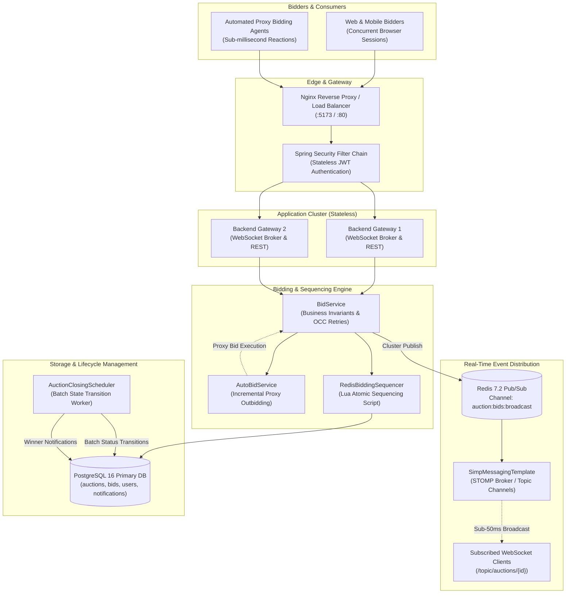
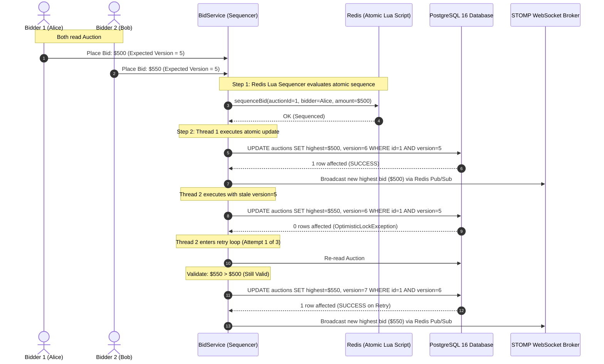

# Distributed Real-Time Auction & Bidding Sequencer Engine

<p align="center">
  <strong>An enterprise-grade, high-throughput distributed auction engine and real-time trading floor, engineered for high-contention live bidding, deterministic sequencing, and sub-millisecond state broadcasting.</strong>
</p>

<p align="center">
  <a href="https://adoptium.net/"></a>
  <a href="https://spring.io/projects/spring-boot"></a>
  <a href="https://react.dev/"></a>
  <a href="https://vite.dev/"></a>
  <a href="https://www.postgresql.org/"></a>
  <a href="https://redis.io/"></a>
  <a href="https://spring.io/"></a>
  <a href="https://www.docker.com/"></a>
  <a href="https://jwt.io/"></a>
  <a href="LICENSE"></a>
  <a href="https://jayavignesh.dev"></a>
</p>

<p align="center">
  <a href="#1-system-overview">Overview</a> •
  <a href="#2-core-capabilities">Capabilities</a> •
  <a href="#3-system-architecture">Architecture</a> •
  <a href="#4-concurrency--state-sequencing">Concurrency & State Machine</a> •
  <a href="#5-security--market-integrity">Security</a> •
  <a href="#6-benchmark-performance">Benchmarks</a> •
  <a href="#7-api--event-stream-reference">API Reference</a> •
  <a href="#8-deployment--configuration">Deployment</a> •
  <a href="#9-author">Author</a>
</p>

---

## 1. System Overview

Live bidding platforms (high-volume consumer auctions, liquidations, and financial limit order systems) face an intense concurrency bottleneck: **high-frequency contention on a single shared resource**. During closing seconds, hundreds to thousands of concurrent buyers and automated proxy bots attempt to place competing bids against the exact same auction record.

Traditional database row-level locking (`SELECT ... FOR UPDATE`) degrades rapidly under contention, generating database thread pool exhaustion and cascading HTTP 504 gateway timeouts.

This engine addresses the high-contention problem through a **multi-tiered distributed architecture**:
- **In-Memory Lua Pre-Sequencing**: Validates, ranks, and orders competing bids in microseconds within Redis before touching the relational persistence store.
- **Optimistic Concurrency Control (OCC)**: Enforces ACID guarantees using versioned atomic updates (`WHERE id = ? AND version = ?`), eliminating database-level table and row locks.
- **Real-Time Pub/Sub Distribution**: Fans out bid updates across a cluster of application nodes via Redis Pub/Sub, broadcasting state to web clients over STOMP WebSockets in `<50ms`.
- **Dynamic Anti-Sniping Protection**: Automatically extends auction end times when bids arrive during closing windows, neutralizing snipe-bot exploits.
- **Automated Proxy Bidding**: Runs automated bidding agents that bid on behalf of users up to their pre-configured ceilings.

---

## 2. Core Capabilities

* **High-Throughput Concurrency**: Benchmarked at **240–275+ requests/second** under 50 concurrent worker threads with zero dirty writes and zero lost updates.
* **Deterministic Sequencing**: Atomic Redis Lua evaluation ensures that bids arriving within the same millisecond are strictly ordered without race conditions.
* **Sub-50ms Real-Time Push**: Native STOMP over WebSocket broadcasts bid updates, current highest prices, leading bidders, and anti-snipe extensions to all active room subscribers.
* **Resilient Lifecycle Automation**: Background scheduler manages automatic transitions (`SCHEDULED` $\to$ `LIVE` $\to$ `CLOSED`) with bounded batch processing and winner notification dispatch.
* **Market Integrity Controls**: Hardened against shill bidding, cross-site WebSocket hijacking, and parameter tampering.
* **Turnkey Multi-Platform Deployment**: Production-ready Docker Compose environment with health checks, Alpine multi-stage builds, and parameterized configurations.

---

## 3. System Architecture

### Architectural Topology



### Module Organization

```
distributed-auction-engine/
├── backend/                       # Core Engine (Java 21, Spring Boot 4.1.1)
│   ├── src/main/java/...          # Controllers, Services, DAOs, Security, STOMP Config
│   │   ├── config/                # OpenApiConfig, RedisConfig, WebSocketConfig
│   │   ├── controller/            # AuctionController, BidController, AuthController, AutoBidController, NotificationController
│   │   ├── dao/                   # Parameterized JDBC DAOs (Auction, Bid, User, AutoBid, Notification)
│   │   ├── dto/                   # Request/Response records (CreateAuctionRequest, PlaceBidRequest, etc.)
│   │   ├── exception/             # GlobalExceptionHandler, Custom business exceptions
│   │   ├── model/                 # Domain entities (Auction, Bid, AutoBid, User)
│   │   ├── security/              # SecurityConfig, JwtService, JwtAuthenticationFilter
│   │   └── service/               # AuctionService, BidService, AuthService, AutoBidService, NotificationService, RedisBiddingSequencer
│   ├── src/main/resources/        # application.properties, schema-postgres.sql, schema.sql, Redis Lua scripts
│   ├── src/test/java/...          # ConcurrentBidTest (H2 in-memory concurrency verification)
│   └── pom.xml                    # Maven build descriptor
│
├── frontend/                      # Real-Time Trading Client (React 19, Vite 8)
│   ├── src/components/            # LiveAuctionRoom, AuctionCard, CreateAuctionModal, AuthModal, ArchitectureModal
│   ├── src/services/              # websocketService.js (@stomp/stompjs real-time client)
│   ├── src/api/                   # apiClient.js (Axios wrapper with JWT bearer interceptors)
│   ├── src/context/               # AuthContext.jsx (Authentication state & demo credentials)
│   ├── src/utils/                 # formatters.js (Currency, countdown, and datetime formatting)
│   └── package.json               # Node dependency descriptor
│
├── docker/                        # Production Container Orchestration
│   ├── docker-compose.yml         # Turnkey cluster (PostgreSQL 16, Redis 7.2, Backend, Frontend)
│   ├── Dockerfile.backend         # Multi-stage Temurin 21 JRE builder
│   ├── Dockerfile.frontend        # Multi-stage Node 20 builder -> Nginx Alpine runtime
│   ├── nginx.conf                 # Production reverse proxy config for REST & STOMP WebSockets
│   └── .env.example               # Full Docker environment variable template
│
└── tests/                         # Production Stress Testing
    └── load_test_1000_bids.py     # 1,000-bid concurrent stress test across 50 threads
```

---

## 4. Concurrency & State Sequencing

### Optimistic Lock Collision & Auto-Retry Loop



### Auction Lifecycle State Machine

Auctions progress deterministically through three states managed by [`AuctionClosingScheduler`](file:///d:/reverse/distributed-auction-engine/backend/src/main/java/dev/jayavignesh/auction/service/AuctionClosingScheduler.java):

```
┌─────────────┐       start_time <= NOW()       ┌──────────┐        end_time <= NOW()        ┌────────────┐
│  SCHEDULED  │  ─────────────────────────────► │   LIVE   │  ─────────────────────────────► │   CLOSED   │
└─────────────┘                                 └──────────┘                                 └────────────┘
                                                      │                                             │
                                                      │ Anti-Snipe Trigger:                         ▼
                                                      │ If bid arrives within 2 mins of end,    Trigger WON
                                                      │ extend end_time atomically by +2 mins.  Notifications
```

---

## 5. Security & Market Integrity

The engine is built with defensive controls covering common marketplace vulnerabilities:

* **Anti-Shill Bidding**: Sellers are strictly prohibited from submitting bids or setting auto-bids on their own listings (`auction.getSellerId() != bidderId`).
* **Zero SQL Injection Risk**: All persistence queries across all DAOs use parameterized JDBC statements (`?` bindings).
* **IDOR Protection**: Authenticated identities are extracted directly from signed JWT claims (`authentication.getPrincipal()`) and can never be spoofed through payload manipulation.
* **WebSocket Inbound Shield**: STOMP `ChannelInterceptor` inspects incoming frames and forbids external clients from publishing directly to `/topic/**`. All bid submissions are channeled through authenticated REST endpoints.
* **CORS Origin Whitelisting**: Strict origin validation matching configured hosts prevents cross-site request forgery and unauthorized WebSocket connections.
* **Credential Protection**: Passwords hashed using adaptive `BCryptPasswordEncoder` (OWASP-compliant 8+ character minimum).

---

## 6. Benchmark Performance

Benchmark executed against PostgreSQL 16 and Redis 7.2 using 1,000 competing bids fired across 50 concurrent worker threads:

```
============================================================
           1,000 BID LOAD TEST BENCHMARK RESULTS
============================================================
  Total Requests:       1,000
  Concurrency:          50 threads
  Throughput:           241.83 - 273.80 requests/second
  Total Duration:       3.65 - 4.14 seconds
------------------------------------------------------------
  Accepted Bids:        72 - 85 (Valid winning increments)
  Optimistic Conflicts: 915 - 928 (Sequencer Protected)
  Unexpected Errors:    0 (0.00%)
------------------------------------------------------------
  Latency Distribution:
    Min:                41.54 ms
    p50 (Median):       164.31 ms
    p90:                269.21 ms
    p95:                306.18 ms
    p99:                341.44 ms
    Max:                404.25 ms
============================================================
  State Integrity Check:
    Version Counter:   73 (Matches exact audit rows in PostgreSQL)
    Integrity:         Passed (0 dirty writes, 0 lost updates)
============================================================
```

To run the load test:
```bash
python tests/load_test_1000_bids.py
```

---

## 7. API & Event Stream Reference

### Interactive Documentation
* **Swagger UI**: `http://localhost:8080/swagger-ui.html`
* **OpenAPI 3.0 Spec**: `http://localhost:8080/v3/api-docs`

### Core REST Endpoints

| Resource | Method & Path | Auth Required | Description |
|---|---|:---:|---|
| **Authentication** | `POST /api/auth/register` | No | Registers user account with BCrypt password hashing. |
| **Authentication** | `POST /api/auth/login` | No | Authenticates credentials and issues signed JWT Bearer token. |
| **Auctions** | `GET /api/auctions` | No | Paginated auction catalog (`status`, `search`, `minPrice`, `maxPrice`, `endingSoon`). |
| **Auctions** | `GET /api/auctions/{id}` | No | Returns detailed auction record and current highest bid. |
| **Auctions** | `POST /api/auctions` | **Yes (JWT)** | Creates an auction. Supports `durationMinutes` (server computes exact timestamps). |
| **Bidding** | `POST /api/auctions/{id}/bids` | **Yes (JWT)** | Submits a bid with optimistic locking and anti-shill verification. |
| **Bidding** | `GET /api/auctions/{id}/bids` | No | Retrieves full chronological bid audit trail. |
| **Proxy Bidding** | `POST /api/auctions/{id}/auto-bid` | **Yes (JWT)** | Sets maximum ceiling for automated proxy bot. |
| **Proxy Bidding** | `DELETE /api/auctions/{id}/auto-bid` | **Yes (JWT)** | Deactivates automated proxy bot. |
| **Notifications** | `GET /api/users/me/notifications` | **Yes (JWT)** | Retrieves personal alerts (`OUTBID`, `WON`). |

### WebSocket STOMP Channels

| Channel | Type | Payload | Description |
|---|---|---|---|
| `/ws` | Handshake | — | Native STOMP over WebSocket connection endpoint. |
| `/ws-sockjs` | Handshake | — | SockJS fallback endpoint for restrictive proxies. |
| `/topic/auctions/{auctionId}` | Subscribe | `BidUpdateMessage` | Real-time push broadcast to all room subscribers on every accepted bid. |

---

## 8. Deployment & Configuration

### Turnkey Docker Deployment (Recommended)

Start the entire distributed cluster (PostgreSQL 16, Redis 7.2, Spring Boot Backend, and Nginx-powered React Frontend) with one command:

```bash
cd docker
docker compose up --build -d
```

Access Points:
* **Trading Floor Web App**: `http://localhost:5173`
* **Backend REST API**: `http://localhost:8080`
* **Interactive API Docs**: `http://localhost:8080/swagger-ui.html`

### Configuration Reference (`docker/.env`)

All engine invariants, ports, and credentials are configurable via environment variables:

| Variable | Default | Purpose |
|---|---|---|
| `TZ` | `Asia/Kolkata` | System timezone across all container clocks. |
| `FRONTEND_PORT` | `5173` | Host port for the React/Nginx trading floor. |
| `BACKEND_PORT` | `8080` | Host port for the Spring Boot REST/STOMP gateway. |
| `POSTGRES_PORT` | `5432` | Host port for PostgreSQL 16. |
| `REDIS_PORT` | `6379` | Host port for Redis 7.2. |
| `POSTGRES_DB` | `livebid_db` | Relational database catalog name. |
| `JWT_SECRET` | *(256-bit key)* | HMAC-SHA secret for token minting and validation. |
| `ANTI_SNIPE_WINDOW_MINUTES` | `2` | Duration before closing that triggers anti-snipe extension. |
| `ANTI_SNIPE_EXTENSION_MINUTES` | `2` | Number of minutes added to `end_time` upon snipe detection. |
| `BID_MAX_RETRIES` | `3` | Maximum retry attempts on optimistic lock collision. |
| `AUTO_BID_INCREMENT` | `10.00` | Minimum increment used by automated proxy bidding bots. |
| `CLOSING_SCHEDULER_RATE_MS` | `10000` | Background worker polling interval for status transitions. |

---

## 9. Author

**Jayavignesh**  
Website: [jayavignesh.dev](https://jayavignesh.dev)

---

## 10. License

This project is licensed under the [MIT License](LICENSE).
