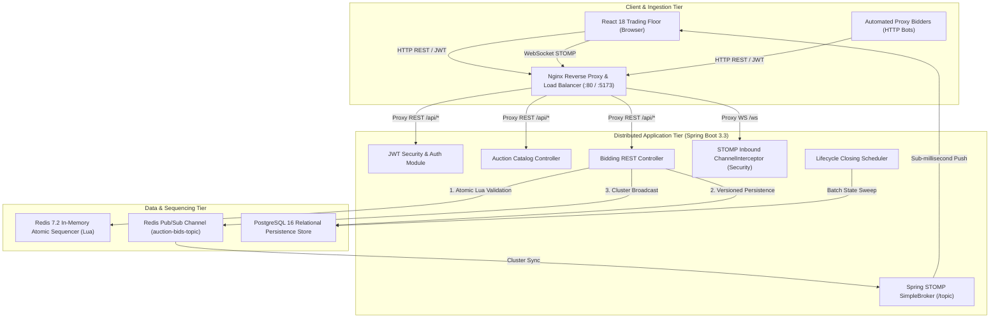
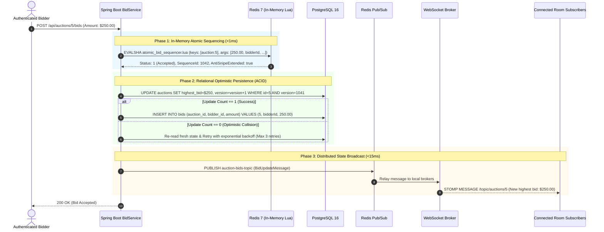

# LiveBid: Distributed Auction Engine Architecture

**Author:** Jayavignesh ([jayavignesh.dev](https://jayavignesh.dev))  
**Version:** 1.0.0 Production  

---

## 1. High-Level Architectural Topology

LiveBid is designed as a distributed, multi-tier system engineered specifically to resolve the **high-contention hot-row bottleneck** inherent in real-time auctions.



---

## 2. The Core Problem: The Single-Resource Contention Bottleneck

In a traditional database-centric application, placing a bid executes a pessimistic row lock:
```sql
-- TRADITIONAL ANTI-PATTERN
BEGIN;
SELECT * FROM auctions WHERE id = 123 FOR UPDATE;
-- Verify bid > current_highest_bid
UPDATE auctions SET current_highest_bid = 1500.00, current_highest_bidder_id = 45 WHERE id = 123;
INSERT INTO bids (auction_id, bidder_id, amount) VALUES (123, 45, 1500.00);
COMMIT;
```

### Why Pessimistic Locking Fails at Scale:
1. **Thread Pool Exhaustion**: If 500 bidders submit bids within 200 milliseconds, 499 threads block on row lock acquisition in PostgreSQL, quickly exhausting database connection pools (HikariCP) and Tomcat request worker threads.
2. **Cascading Deadlocks**: Concurrent proxy bots evaluating bids simultaneously across multiple listings trigger circular wait conditions.
3. **High Latency**: Lock wait times scale linearly with concurrency, causing HTTP 504 Gateway Timeouts during closing seconds.

---

## 3. The LiveBid Solution: Hybrid Memory-Relational Concurrency

LiveBid solves this with a two-phase concurrency model:



---

## 4. Redis Lua Sequencer Internals

The Lua script located at [`backend/src/main/resources/redis/atomic_bid_sequencer.lua`](file:///d:/reverse/distributed-auction-engine/backend/src/main/resources/redis/atomic_bid_sequencer.lua) executes inside Redis's single-threaded event loop:

1. **Existence & State Verification**: Checks `status == 'LIVE'` and validates that current server timestamp $< \text{end\_time}$.
2. **Monotonic Price Guard**: Asserts $\text{bid\_amount} \ge \text{current\_highest\_bid} + \text{min\_increment}$.
3. **Anti-Sniping Clock Extension**: If the bid arrives within the `anti_snipe_window` (default: 2 minutes of closing), `end_time` is automatically extended by `anti_snipe_extension` (default: 2 minutes).
4. **Atomic Sequence Generation**: Atomically increments an integer sequencer key, returning a deterministic sequence ID.

Because Redis executes Lua scripts atomically without interleaving commands, race conditions are mathematically prevented at the sequencer level.

---

## 5. Horizontal WebSocket STOMP Clustering

When deploying multiple backend container instances behind a load balancer, client WebSockets terminate on different physical servers. LiveBid bridges Redis Pub/Sub with Spring's native STOMP broker:

1. A bid is accepted on **Node A**.
2. Node A publishes the event to Redis channel `auction-bids-topic`.
3. **Node A, Node B, and Node C** listen to `auction-bids-topic` via Spring Data Redis `MessageListenerAdapter`.
4. Each node converts and pushes the message to its local STOMP subscribers on `/topic/auctions/{id}`.
5. All connected web clients receive the updated state simultaneously, regardless of which instance holds their WebSocket connection.

---

## 6. Security & Market Integrity Architecture

* **Anti-Shill Bidding**: Sellers cannot place manual bids or configure automated proxy bidding bots on listings they created (`auction.getSellerId() != bidderId`).
* **Authoritative System Clock**: Auction duration is calculated exclusively by the server (`startTime + durationMinutes`), eliminating client-side clock skew.
* **Inbound STOMP Frame Firewall**: A Spring `ChannelInterceptor` inspects every incoming STOMP command and rejects any client attempting to issue `SEND` commands directly to `/topic/**`.
* **OWASP Compliance**: BCrypt password hashing, minimum 8-character password policies, and strict CORS origin whitelisting with credential validation.

