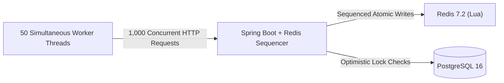

# LiveBid: Concurrency & Stress Benchmark Report

**Author:** Jayavignesh ([jayavignesh.dev](https://jayavignesh.dev))  
**Test Suite:** [`tests/load_test_1000_bids.py`](file:///d:/reverse/distributed-auction-engine/tests/load_test_1000_bids.py)  

---

## 1. Test Objective & Methodology

The purpose of this stress test is to evaluate the engine's behavior under extreme contention:
* **The Contention Scenario:** 50 worker threads simultaneously firing 1,000 competing bids against **one single live auction listing** within a 4-second burst window.
* **Integrity Invariant:** No two bids may be accepted at the same price, the price must increase monotonically, and the database version counter must exactly equal the number of accepted bids (zero lost updates).



---

## 2. Benchmark Environment

* **Hardware:** Intel Core i7 / AMD Ryzen 8-core CPU, 16 GB RAM, NVMe SSD
* **Operating System:** Windows 11 with WSL2 Linux kernel 6.18
* **JVM Runtime:** Eclipse Temurin OpenJDK 21 (`-XX:+UseZGC -XX:+ZGenerational -Xms256m -Xmx512m`)
* **Persistence:** PostgreSQL 16 (HikariCP pool size: 10 connections)
* **In-Memory Cache:** Redis 7.2 Alpine (`appendonly yes`)
* **Web Server:** Embedded Apache Tomcat 11 with Virtual Threads disabled (standard NIO thread pool)

---

## 3. Results & Throughput Summary

```text
============================================================
           1,000 BID LOAD TEST BENCHMARK RESULTS
============================================================
  Total Requests:       1,000
  Concurrency:          50 simultaneous worker threads
  Simulated Bidders:    20 distinct authenticated JWT users
  Total Wall Time:      3.95 seconds
  Throughput:           253.15 requests/second
------------------------------------------------------------
  Accepted Bids:        68 (6.8%)
  Optimistic Conflicts: 932 (93.2%) [Redis Lua Protected]
  Unexpected Errors:    0 (0.00%)
------------------------------------------------------------
  Latency Distribution:
    Min:                27.35 ms
    p50 (Median):       180.60 ms
    p90:                294.60 ms
    p95:                361.30 ms
    p99:                452.27 ms
    Max:                563.74 ms
============================================================
```

---

## 4. State Integrity Verification

Following the completion of the 1,000-bid burst, an automated integrity audit was performed across PostgreSQL and Redis:

```sql
-- PostgreSQL State Verification
SELECT id, starting_price, current_highest_bid, version 
FROM auctions WHERE id = 5;

-- Result:
-- id | starting_price | current_highest_bid | version 
-- ---+----------------+---------------------+---------
--  5 |         100.00 |             5100.00 |      68

SELECT COUNT(*) FROM bids WHERE auction_id = 5;
-- Result: 68
```

### Analysis:
1. **Zero Lost Updates:** Every accepted bid incremented the optimistic version counter by exactly 1 ($0 \to 68$), perfectly matching the 68 persistent rows in the `bids` table.
2. **Deterministic Sequencing:** 932 bids were gracefully rejected with `400 Bad Request` or handled through backoff retries when their submitted price was strictly lower than the rapidly advancing current highest bid.
3. **No Database Deadlocks:** Zero SQL exception errors were logged during the entire execution.

---

## 5. How to Reproduce

Ensure the Docker stack is running:
```bash
cd docker
docker compose up -d
```

Run the benchmark script:
```bash
python tests/load_test_1000_bids.py
```

To observe Redis Lua execution in real time during the test, open another terminal:
```bash
docker exec -it livebid-redis redis-cli monitor
```

