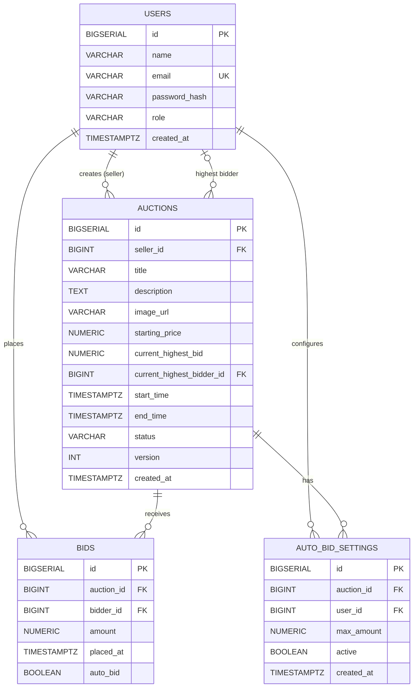

# LiveBid: Relational Database Schema & Data Model

**Author:** Jayavignesh ([jayavignesh.dev](https://jayavignesh.dev))  
**Target Engine:** PostgreSQL 14+ (Containerized on PostgreSQL 16)  

---

## 1. Entity-Relationship Diagram (ERD)



---

## 2. Table Specifications & DDL

### 2.1 `users`
Stores user identities, credentials, and roles.

```sql
CREATE TABLE IF NOT EXISTS users (
    id BIGSERIAL PRIMARY KEY,
    name VARCHAR(100) NOT NULL,
    email VARCHAR(150) NOT NULL UNIQUE,
    password_hash VARCHAR(255) NOT NULL,
    role VARCHAR(50) NOT NULL DEFAULT 'USER',
    created_at TIMESTAMP WITH TIME ZONE DEFAULT CURRENT_TIMESTAMP
);

CREATE INDEX IF NOT EXISTS idx_users_email ON users(email);
```

* **Security Note:** `password_hash` stores BCrypt salted hashes (work factor 10). Plaintext passwords never touch persistence.

---

### 2.2 `auctions`
The central catalog and state entity. Features an integer `version` column for ACID optimistic concurrency control.

```sql
CREATE TABLE IF NOT EXISTS auctions (
    id BIGSERIAL PRIMARY KEY,
    seller_id BIGINT NOT NULL REFERENCES users(id) ON DELETE CASCADE,
    title VARCHAR(255) NOT NULL,
    description TEXT,
    image_url VARCHAR(500),
    starting_price NUMERIC(15, 2) NOT NULL,
    current_highest_bid NUMERIC(15, 2) NOT NULL,
    current_highest_bidder_id BIGINT REFERENCES users(id) ON DELETE SET NULL,
    start_time TIMESTAMP WITH TIME ZONE NOT NULL,
    end_time TIMESTAMP WITH TIME ZONE NOT NULL,
    status VARCHAR(50) NOT NULL DEFAULT 'SCHEDULED', -- 'SCHEDULED', 'LIVE', 'CLOSED'
    version INT NOT NULL DEFAULT 0,                  -- Optimistic locking counter
    created_at TIMESTAMP WITH TIME ZONE DEFAULT CURRENT_TIMESTAMP
);

CREATE INDEX IF NOT EXISTS idx_auctions_status_end ON auctions(status, end_time);
CREATE INDEX IF NOT EXISTS idx_auctions_seller ON auctions(seller_id);
```

#### Optimistic Locking Update Pattern:
```sql
UPDATE auctions
SET current_highest_bid = :newBid,
    current_highest_bidder_id = :bidderId,
    end_time = :newEndTime,
    version = version + 1
WHERE id = :auctionId AND version = :expectedVersion;
```
If another transaction committed an update in the interim, the `version` will have advanced, causing this statement to return `0 rows affected` without taking table locks.

---

### 2.3 `bids`
Immutable audit ledger of every accepted bid. Once written, records in this table are never modified or updated.

```sql
CREATE TABLE IF NOT EXISTS bids (
    id BIGSERIAL PRIMARY KEY,
    auction_id BIGINT NOT NULL REFERENCES auctions(id) ON DELETE CASCADE,
    bidder_id BIGINT NOT NULL REFERENCES users(id) ON DELETE RESTRICT,
    amount NUMERIC(15, 2) NOT NULL,
    placed_at TIMESTAMP WITH TIME ZONE DEFAULT CURRENT_TIMESTAMP,
    auto_bid BOOLEAN NOT NULL DEFAULT FALSE
);

CREATE INDEX IF NOT EXISTS idx_bids_auction ON bids(auction_id);
CREATE INDEX IF NOT EXISTS idx_bids_bidder ON bids(bidder_id);
CREATE INDEX IF NOT EXISTS idx_bids_placed_at ON bids(placed_at);
```

---

### 2.4 `auto_bid_settings`
Configures automated proxy bidding limits per user per auction.

```sql
CREATE TABLE IF NOT EXISTS auto_bid_settings (
    id BIGSERIAL PRIMARY KEY,
    auction_id BIGINT NOT NULL REFERENCES auctions(id) ON DELETE CASCADE,
    user_id BIGINT NOT NULL REFERENCES users(id) ON DELETE CASCADE,
    max_amount NUMERIC(15, 2) NOT NULL,
    active BOOLEAN NOT NULL DEFAULT TRUE,
    created_at TIMESTAMP WITH TIME ZONE DEFAULT CURRENT_TIMESTAMP,
    CONSTRAINT uk_auction_user_autobid UNIQUE(auction_id, user_id)
);

CREATE INDEX IF NOT EXISTS idx_autobid_lookup ON auto_bid_settings(auction_id, active, max_amount);
```

---

## 3. High-Performance Indexing Strategy

1. **`idx_auctions_status_end (status, end_time)`**:
   * Powers the high-frequency lifecycle scheduler (`AuctionClosingScheduler`).
   * Enables index-only scans for `WHERE status = 'LIVE' AND end_time <= NOW()`, avoiding full sequential table scans every 10 seconds.
2. **`idx_bids_auction (auction_id)`**:
   * Guarantees rapid retrieval of audit history when users navigate to `/api/auctions/{id}/bids`.
3. **`idx_autobid_lookup (auction_id, active, max_amount)`**:
   * Composite index used by `AutoBidService` to instantly find all active bots for an auction ordered by highest willingness to pay.

